<!--
    Hey there, I'm Eyad Sharkawy!
    Happy to see you here exploring my README code.
    Feel free to take inspiration!
-->

  

<table>
  <tr>
    <td valign="top"></td>
    <td valign="top"></td>
  </tr>
</table>

 

<table>
  <tr>
    <td valign="top"></td>
    <td valign="top"></td>
  </tr>
</table>

### Background & Focus

I am a Software Developer specializing primarily in enterprise backend architectures with **Java Spring Boot**, paired with modern frontend engineering in **Angular**, alongside a strong foundation in modern **C++**.

Based in **Cairo, Egypt**, I actively contribute to open-source fintech ecosystems like **[Apache Fineract](https://github.com/apache/fineract)** (backend Java Spring Boot) and **[Mifos](https://github.com/openMF/web-app)** (enterprise Angular frontend), engineering robust, containerized systems with clean, scalable design patterns.

---

### Open Source Contributions

&nbsp;&nbsp;

- **[Apache Fineract](https://github.com/apache/fineract)** — An open-source, enterprise system for core banking as an OS. Contributing backend enhancements, bug fixes, and architectural optimizations in **Java Spring Boot**. [View Merged Pull Requests →](https://github.com/search?q=repo:apache/fineract+author:Eyad-Sharkawy+is:pr+is:merged&type=pullrequests)
- **[Mifos Initiative](https://github.com/openMF/web-app)** — Global financial inclusion initiative powering microfinance institutions worldwide. Shipping enterprise **Angular** & **TypeScript** frontend features. [View Merged Pull Requests →](https://github.com/search?q=org:openMF+author:Eyad-Sharkawy+is:pr+is:merged&type=pullrequests)

---

### Connect With Me

 

  

  

