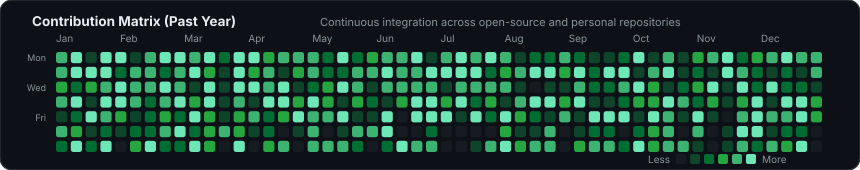

<!--
    Hey there, I'm Eyad Sharkawy!
    Happy to see you here exploring my README code.
    Feel free to take inspiration!
-->

  

<table>
  <tr>
    <td valign="top"></td>
    <td valign="top"></td>
  </tr>
</table>

 

<table>
  <tr>
    <td valign="top"></td>
    <td valign="top"></td>
  </tr>
</table>

### Background & Focus

I am a Full-Stack Developer specializing in enterprise and modern web applications using **Java Spring Boot** and **Angular**, alongside a strong foundation in modern **C++**.

Currently studying at **FCAI-CU**, I focus heavily on the **Applied Software Solutions** track—building scalable, multi-tenant architectures, containerized infrastructure, and seamlessly integrated AI solutions, while actively contributing to open-source fintech ecosystems like **[Apache Fineract](https://github.com/apache/fineract)** and **[Mifos](https://github.com/openMF/web-app)**.

---

### 🚀 Highlighted Systems & Engineering Work

- **Enterprise & Architecture:** Built **[Agency OS](https://github.com/Agnecy-OS)** and **[Omni Sync](https://github.com/Eyad-Sharkawy/omni-sync)** with an emphasis on resilient data flow and multi-tenant architectures.
- **Full-Stack & AI Platforms:** Collaborated on **[The Phoenix Project](https://github.com/orgs/The-Phoenix-Project-Depi/repositories)** and **[Photo Smith](https://github.com/Eyad-Sharkawy/Photo-Smith)**, in addition to award-winning tech competition projects.
- **Fintech Open Source:** Shipped merged contributions to **[Apache Fineract](https://github.com/search?q=repo:apache/fineract+author:Eyad-Sharkawy+is:pr+is:merged&type=pullrequests)** and **[Mifos](https://github.com/search?q=org:openMF+author:Eyad-Sharkawy+is:pr+is:merged&type=pullrequests)** core repositories.

---

### 🌐 Connect With Me

 

  

  

